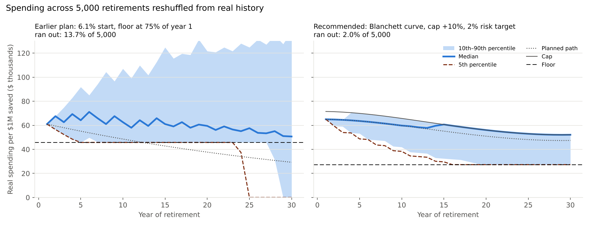
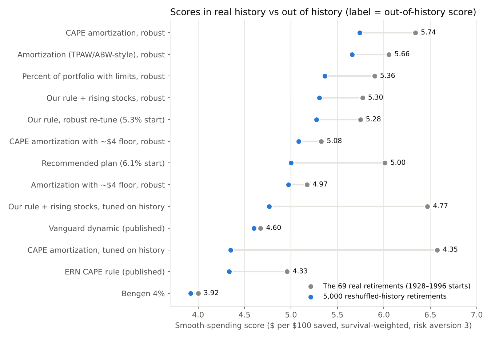
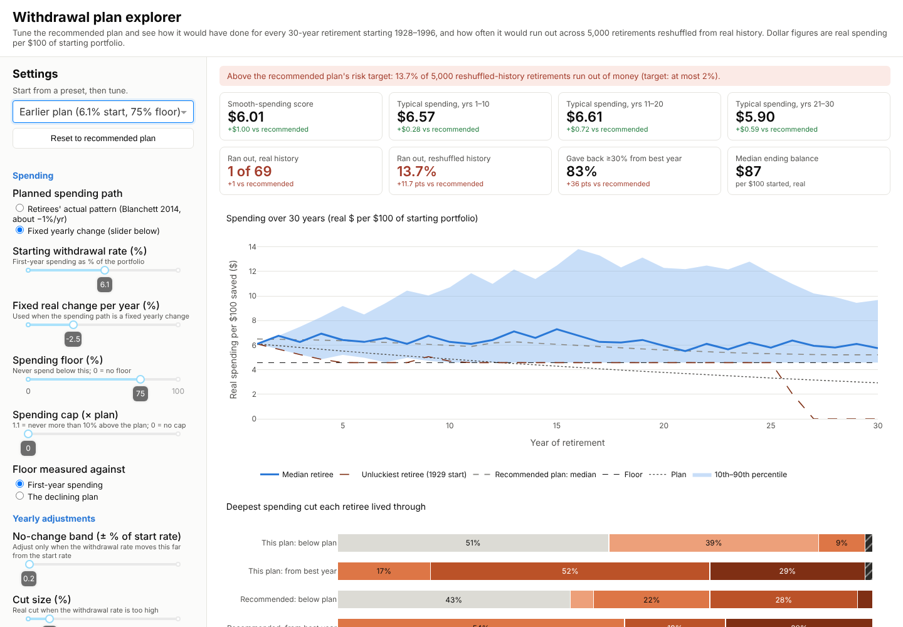

# Beyond the 4% rule — a historical backtest

Re-runs William P. Bengen, "Determining Withdrawal Rates Using Historical Data"
(*Journal of Financial Planning*, Oct 1994), then tests flexible spending rules, allocation,
front-loading and international diversification on actual returns through 2025.

**Full write-up with charts: [docs/beyond-the-4pct-rule.md](docs/beyond-the-4pct-rule.md)**

## Recommended plan

Spend the way retirees actually do, cap the good years, and keep the chance of running out near 2%.
Per $1 million saved, in today's dollars:

1. Start at **$65,000 (6.5%)** with **80% stocks** (30% of them international) and 20% bonds.
2. Plan for spending to follow **retirees' observed pattern** (Blanchett 2014): about −1% a year after
   inflation, gentlest in the 60s and late 80s, steepest around age 78 (−27% over 30 years).
3. Each year compare planned spending with the portfolio. If the withdrawal rate is more than 22% above
   the 6.5% start (above 7.9%), **cut 8.5%**; if more than 22% below (under 5.1%), **raise up to 15%**.
4. Never spend more than **10% above the planned path**, and never less than **$27,300** (42% of year 1).
   Money left over is the reserve for late-life long-term care.



| Per $1M saved | Recommended plan | Earlier plan (6.1%, 75% floor) | Bengen 4% |
|---|---|---|---|
| First-year spending | $65,000 | $61,000 | $40,000 |
| Floor (never below) | $27,300 | $45,750 | none |
| Typical spending, year 1 / 10 / 20 / 30 | $65,000 / $59,800 / $56,100 / $52,100 | $61,000 / $62,600 / $59,500 / $50,700 | $40,000 flat |
| Ran out: 69 real retirements (no fee / 0.25% / 0.5% fee) | 0 / 0 / 0 | 1 / 6 / 9 | 0 / 0 / 1 |
| Ran out: 5,000 reshuffled retirements (no fee / 0.25% fee) | **2.0% / 2.8%** | 13.7% / 16.3% | 4.9% / 6.2% |
| Ever spend below $30,000 (reshuffled) | 23% | 14% | 5% |
| Typical balance at year 30 (reshuffled) | $1.09M | $0.73M | $1.23M |

Typical = median retiree. "Reshuffled" retirements stitch together random runs of real years (10 on
average) from 1928–2025, so they include plenty of bad sequences that never happened but could have.

The trade-off: the earlier plan promised never to fall below $45,750 but drained the account in about
1 retirement in 7 when history didn't repeat itself exactly. The recommended plan's floor is lower, so
about 1 in 4 retirees have a lean stretch below $30,000 after a bad start, but only 1 in 50 runs out.
Its smooth-spending score is slightly lower ($4.87 vs $5.00 per $100, reshuffled) because the cap leaves
good-year money invested. Why the plan changed, and the other strategies tried, are in
[Testing beyond history](#testing-beyond-history-why-the-plan-changed).

## Key findings

69 overlapping 30-year retirements starting 1928–1996. Spending in real dollars per $100 of
starting portfolio; "typical" = median retiree.

| Change added | Safe starting rate | Typical spending, yrs 1–10 | Failures (of 69) |
|---|---|---|---|
| Bengen: constant real spending, 50/50 US | 4.0% (max 4.16%, worst start 1966) | $4.00 | 0 |
| Guardrails ±30%, $4 floor, 80% stocks | 5.5% | $5.67 | 0 |
| Real spending −0.5%/yr, floor declines too | 6.3% | $6.29 | 0 |
| 25% of stocks international | 8.0% | $7.42 | 0 |
| Accept 95% success | 9.0% | $8.02 | 3 |

- Guardrails without a floor make things worse; a floor plus large steps is what works.
- About 80% stocks is the sweet spot; at 90%+ the 1929 retiree always fails. Leverage never helps.
- Front-loading helps only if the minimum declines too. A spending ceiling never raises the safe rate.
- 25% international is the biggest single gain and survives stress tests.
- These are in-sample optimums (no fees or taxes); a realistic target is 1–1.5 points lower.


Each line is the highest starting rate a retiree starting that year could have used; its lowest
point is the safe rate in the table. For the guardrail variants "safe" means spending never fell
below the $4 floor and the money lasted, so a high start in a good year is cut back, not sustained.

## How the ±30% guardrails work

Each January (8% plan): raise last year's spending by inflation and trim it 0.5%, then divide by the
current portfolio. If that withdrawal rate is above **9.6%** (8% + 20%), cut spending **30%**; if it is
below **6.4%** (8% − 20%), raise it **30%**; otherwise leave it. Spending never goes below the $4 floor
(declining 0.5% a year) or above the 2× cap. "±30%" is the size of the move; the band is the trigger.


- **1966 (bad start):** cut in years 5 and 9, then held at the floor for 20 of 30 years; ends with $9 left.
- **1982 (good start):** three raises to about $14.70 by year 18, two cuts after the 2000s crashes; ends with $89 left.
- Across all 69 retirees: typically 3 cuts and 3 raises in 30 years, first cut around year 6;
  about 68% of years see no change beyond inflation and the trim.
- **±25% steps give the same 8.0% safe start** with gentler swings (about $0.13 a year less early
  spending), a better fit for anyone who would find a 30% pay cut hard to live with.

## What it feels like: how often spending is cut

Higher starting rates are paid for with frequent deep cuts. Each retiree is placed by their deepest
real spending cut: below the plan (planned 0.5% trims excluded), and from their best year so far.
Shares are of the 69 historical retirees (overlapping windows, so frequencies, not forecasts).


| Strategy | Typical spending, yrs 1–10 | Cut ≥30% below plan | Cut ≥30% from best year |
|---|---|---|---|
| Bengen 4.0% | $4.00 | 0% | 0% |
| Bengen 5.0% | $5.00 | 25% (ran out) | 25% (ran out) |
| Guardrails, US, 5.5% | $5.67 | 0% | 58% |
| + 25% international, 8.0% | $7.42 | 83% | 100% |
| 95% success plan, 9.0% | $8.02 | 97% | 100% |

- Rigid spending trades cuts for a rare total loss: Bengen at 5% ran out for a quarter of retirees.
- On the 8% plan nearly half of retirees hit the floor (a 50% cut below plan), and a typical retiree
  spends 14 of 30 years at least 15% below plan. Nearly everyone gives back 30%+ from their best year.
- The US guardrails plan at 5.5% is the gentlest step up: no cut ever deeper than 27% below plan.

## Does a cash bucket help?

Barely. A 10% cash bucket (taken from bonds) is spent first, then bonds, while stocks are 10%+
below their peak, for up to 5 years without selling stocks, then refilled by a fifth of its target
in each up year.


| | No cash | Static 10% cash | 10% cash bucket |
|---|---|---|---|
| Bengen 50/50: safe start | 4.16% | 4.18% | 4.14% |
| 8% plan: safe start, no failures | 8.06% | 8.12% | 8.20% |
| 8% plan: safe start, 95% success | 9.02% | 8.74% | 9.22% |
| 8% plan at 8%: cut ≥30% below plan | 77% | 78% | 74% |

10% covers only about 1.25 years of spending on the 8% plan, the 1966 retiree's damage came long
after the cash was gone, and annual rebalancing already buys stocks in down years. This matches
published research (Estrada 2018; Woerheide & Nanigan; Early Retirement Now Part 48). It slightly
softens the worst outcomes, so it is a reasonable comfort tool, not a way to raise the safe rate.

More charts: [Bengen replication](docs/img/safemax_by_start_year.png) ·
[international share](docs/img/intl_share_sweep.png) · full write-up in
[docs/beyond-the-4pct-rule.md](docs/beyond-the-4pct-rule.md).

*Not financial advice: a historical study of US and developed-market returns, 1928–2025.*

## Testing beyond history: why the plan changed

The earlier plan (6.1% start, 75% floor) was tuned on the same 69 overlapping retirements it was
scored on, which hold only about three truly independent 30-year periods. Three checks showed it was
fitted too closely:

- **Fees:** a 0.25% yearly fee raised its run-outs from 1 to 6 of 69 (all 1929 and 1960s starts).
- **Reshuffled history:** across 5,000 block-bootstrapped retirements, 13.7% ran out.
- **Split sample:** the same rule tuned on 1928–61 starts ran out for 10 of the 35 later retirees.

The weak point was the floor: $45,750 per $1M, never cut, is above the roughly $40,000 that history
has supported as spending that never falls, and buying it as a real guarantee (a 30-year TIPS ladder
at about 2%) would cost more than the whole portfolio.

**Strategies from the literature.** On the same engine and score: amortization rules (Bogleheads' ABW
and VPW, TPAW-style), a CAPE-aware amortization rule and Early Retirement Now's CAPE rule, Vanguard's
dynamic spending rule, a rising-stock glidepath, and a TIPS-ladder floor with stock upside. Several
looked better in history (CAPE amortization +9%, glidepath +8%) and then lost most of their edge,
or ran out more, out of history.



- With a hard floor, our rule (planned path, cuts and raises outside a band, floor) beat every
  alternative once tuned on reshuffled history.
- Amortization without a hard floor scored about 7% higher out of history but left a third of
  retirees below $39,000 at some point; CAPE added only about 1.5% more.
- A rising glidepath added about 0.4% once tuned robustly; the TIPS-ladder floor can't fund a
  useful floor at today's real yields.

**How the plan was set.** All settings, including the floor, were tuned on 2,000 reshuffled
retirements to maximise the smooth-spending score with at most 2% running out, then checked on 5,000
fresh ones, on real history and with fees. Caps of 1%, 2%, 3% and 5% were tried; 2% gave most of the
safety without pushing the floor too low (at 1% it falls to about $21,000–24,000). Spending follows
Blanchett's age curve (−0.96% a year on average in household data; J.P. Morgan finds spending more
than 30% lower at 85 than at 60). Without a cap, good markets pushed typical spending *up* over time,
against that curve; capping it at 10% above the planned path keeps the smile and lets the plan start
$7,000 higher than an uncapped version.

```bash
python scripts/alt_optimize.py --boot 2000 --max-out 0.02 --families "Our rule, floor tuned, Blanchett spending curve" --set ceiling=1.1 --name cap110
python scripts/alt_robust.py final         # fees, reshuffled history, other settings
python scripts/alt_charts.py               # charts in output/alt/
python scripts/plan_summary.py             # the table above
```

Sources: Blanchett, "Exploring the Retirement Consumption Puzzle", *Journal of Financial Planning*
(May 2014); J.P. Morgan Asset Management, *Retirement by the Numbers*; Kitces and Income Lab on
risk-based guardrails; Early Retirement Now, SWR series parts 18, 19 and 54; Advisor Perspectives,
"Beyond the 4% Rule: Flexible Withdrawal Strategies Using Certainty-Equivalent Spending" (2021);
Vanguard's dynamic spending rule; Morningstar, safe withdrawal rate research (2026).

## Quick start
```bash
python -m venv .venv && source .venv/bin/activate
pip install -e ".[dev]"
python scripts/reproduce.py --download   # fetch fresh data, then run
python scripts/reproduce.py              # or run on the bundled snapshot
pytest
```
Outputs land in `output/`: `results.md`, `safemax_30yr_50_50.csv`, and three charts.

Options: `--timing start|end` (default `end`), `--bonds intermediate|10y` (default `intermediate`).

## Interactive dashboard
Tune the recommended plan and watch all 69 historical retirements update live (Dash + Plotly; each change re-simulates in a few milliseconds).
```bash
pip install -e .
pip install -r app/requirements.txt
python app/dashboard.py                  # then open http://127.0.0.1:8050
```
Controls cover the starting rate, the planned spending path (Blanchett's curve or a fixed yearly change), floor and cap, guardrail band and cut/raise sizes, stock and international mix, the optional cash bucket, and the data and scoring choices. Presets load the recommended plan, the earlier 6.1% plan, Bengen's 4% rule and the 8% plan. Every tile shows the difference from the recommended plan, including the share of 5,000 reshuffled-history retirements that run out; a warning appears when that is above the plan's 2% target.



## Experiments

### Guardrails (`scripts/guardrails.py`)
Guyton-Klinger-style rule: each year spending rises with inflation, then is cut by `step`
if the current withdrawal rate is above `initial × (1 + band)` or raised by `step` if it is
below `initial × (1 − band)`. **`--steps` is the variance knob**: the largest real change in
spending in any single year. `step = 0` is exactly Bengen's rule.

```bash
python scripts/guardrails.py                          # 4% and 5%, steps 0–25%
python scripts/guardrails.py --floor 0.8 --name floor80
python scripts/guardrails.py --rates 0.055 --steps 0,0.1,0.2 --band 0.15 --gk
```
Options: `--band`, `--floor` / `--ceiling` (multiples of year-1 real spending), `--gk`
(skip inflation raise after a losing year; no cuts in the last 15 years), `--stocks`,
`--horizon`, `--focus-year`. Outputs go to `output/guardrails/[name]/`.

### Best-strategy search (`scripts/optimize.py`)
Grid over stock share (60%–125%, above 100% = leverage at T-bills + 1%), guardrail step,
spending ceiling and planned real drift. For each combination it finds the highest starting rate
(0.1% grid) at which the required share of historical retirees succeed. Success = real spending
never below `--target` (default $4 per $100) and never running out. A floor sits at the target.

- `--success 0.95`: required historical success rate (overrides `--allow K`).
- `--drifts 0,-0.005`: planned real spending change per year (−0.005 = inflation − 0.5%).
  By default the floor declines at the same rate; `--flat-floor` keeps it flat.
- `--ceilings 0,1,1.25,1.5,2,3`: cap on spending as a multiple of the planned path (0 = none).
- `--rank early|avg`: rank by median spending in years 1–10 (default) or over all years.

```bash
python scripts/optimize.py --success 0.95 --name p95
python scripts/optimize.py --success 1.0  --name strict
```
Outputs in `output/optimize/[name]/`: `results.md`, `optimize_grid.csv`, heatmaps per drift,
`spending_fan_top_pick.png` and `spending_shape.png` (median vs 5th-percentile retiree).

### International diversification (`--intl`, `scripts/intl_sweep.py`)
`--intl 0.25` (the default in `optimize.py` and `guardrails.py`) puts 25% of the stock allocation in
developed ex-US stocks, rebalanced yearly. `reproduce.py` stays US-only to match Bengen.
`--intl-stress` uses a pessimistic series where wartime data gaps are filled with heavy losses.

```bash
python scripts/intl_sweep.py                       # max safe start vs intl share, fixed strategy
python scripts/optimize.py --success 0.95 --intl 0 --name p95_us
python scripts/optimize.py --success 0.95 --name p95_intl25
python scripts/build_intl.py [JSTdatasetR6.csv]    # rebuild data/raw/intl_stocks.csv
# The raw JST file is not in the repo: download JSTdatasetR6 from https://www.macrohistory.net/database/
# into data/external/ (as CSV). The derived series data/raw/intl_stocks.csv is included.
```

### Variant comparison and guardrail traces
```bash
python scripts/safemax_variants.py                 # safe start by start year, four variants
python scripts/explain_guardrails.py               # 1966 and 1982 traces + how often the rule acts
python scripts/explain_guardrails.py --years 1929,1973
```
Outputs in `output/variants/`: the two charts, per-year CSVs and per-retiree trace CSVs.

### Spending pain and cash bucket
```bash
python scripts/pain_analysis.py                    # cut-severity levels by strategy -> output/pain/
python scripts/cash_bucket.py                      # 10% bucket vs no cash vs static cash -> output/bucket/
python scripts/cash_bucket.py --cash 0.15 --threshold 0.2 --max-years 5 --refill-years 5
```

### Recommended plan and other optimisations
`src/bengen/vec.py` simulates all 69 retirees at once (about 2.6 ms per plan), with separate cut and
raise sizes, a floor and cap, a phased spending plan and an optional cash bucket. The optimisers maximise
certainty-equivalent spending (risk aversion 3, years weighted by a couple's survival from the SSA
2022 life table in `data/raw/ssa_period_life_2022.csv`) under hard limits on extreme cuts.
```bash
python scripts/decline_optimize.py                 # recommended family: declining plan, 75% floor, raise caps
python scripts/decline_optimize.py --seed 22 --name seed22   # extra seeds; best per family kept in output/decline/best
python scripts/decline_charts.py                   # charts for the recommended plan
python scripts/experiment_map.py                   # every strategy on one chart
python scripts/smooth_optimize.py && python scripts/smooth_charts.py       # smooth-score experiment
python scripts/smile_optimize.py && python scripts/smile_charts.py         # spending-smile experiment
python scripts/smile_optimize.py --shape mirror --name mirror && python scripts/smile_mirror_charts.py
```
The `decline/best` folder merges the best of three seeds; rerunning reproduces it with seeds 21–23.
The current recommended plan comes from `scripts/alt_optimize.py` (see
[Testing beyond history](#testing-beyond-history-why-the-plan-changed)); `src/bengen/alt.py` holds the
alternative strategies and the reshuffled-history (block bootstrap) sampler.

## Data
| Series | Source | Notes |
|---|---|---|
| Stocks | Damodaran, S&P 500 total return (histretSP.xls) | 1928– |
| Bonds | Damodaran, 10-yr US Treasury total return | 1928– |
| Bills | Damodaran, 3-month T-bill | used for the intermediate-bond proxy |
| Inflation | CPI-U NSA, Dec→Dec (FRED `CPIAUCNS`) | |
| International stocks | 1928–69: JST Macrohistory R6 (CC BY-NC-SA 4.0), 15 developed countries, USD, real-GDP weighted; 1970–2025: MSCI World ex USA (USD total return) | `data/raw/intl_stocks.csv` |

International notes: JST lacks equity data for Canada and Ireland; Germany 1949 uses the official DM
parity because JST's exchange rate straddles the 1948 currency reform; country-years with missing
data are skipped (the `intl_stress` column fills them with heavy losses instead). JST's Japanese
returns look smoothed after 1970, so MSCI replaces JST from 1970. MSCI World ex USA was checked
against MSCI's official EAFE factsheet for 2012–2025 (within ~2pp a year; the gap is Canada).

`data/raw/*.csv` is a snapshot transcribed from Damodaran's web table and
usinflationcalculator.com's Dec→Dec table. `--download` pulls the original files and
saves `*_downloaded.csv`, which are then preferred — diff them against the snapshot once.

## Method (as in Bengen 1994)
- Portfolio starts at 1.0 on Jan 1 of the retirement year; first withdrawal = rate × 1.0.
- Withdrawals rise each year with CPI (constant real spending).
- Rebalanced annually to a fixed stock/bond mix.
- **Bengen mode:** actual data through 1992, then each series' historical average (Bengen's data ended in 1992).
- Retirees start 1928–1976 (Bengen: 1926–1976; Damodaran's data starts in 1928).

## Known differences from the paper
- Bengen used Ibbotson SBBI large-company stocks and **intermediate-term** government bonds (~5-yr).
  Damodaran only has 10-yr Treasuries, which lost more in 1966–81. The default `intermediate` proxy
  (½ T-bills + ½ 10-yr) approximates a ~5-yr duration and closes most of the gap; use `--bonds 10y` to see the raw effect.
- Bengen's post-1992 averages came from Ibbotson 1926–92; ours are computed from this data (1928–92).

## License

- **Code:** [MIT](LICENSE).
- **`data/raw/intl_stocks.csv`:** derived from the Jordà-Schularick-Taylor Macrohistory Database, so it
  is licensed **[CC BY-NC-SA 4.0](data/raw/LICENSE-intl_stocks.md)**: non-commercial use only, share
  alike, with attribution. Results and charts that use the international series (the `--intl` options,
  `output/optimize`, `output/intl`, `output/variants`, and the international figures in the write-up)
  are shared under the same terms.
- **Other data** keep their sources' terms: Damodaran (NYU Stern) returns, US CPI, and MSCI index returns.

If you use the international data, cite:

- Jordà, Schularick and Taylor (2017), "Macrofinancial History and the New Business Cycle Facts",
  *NBER Macroeconomics Annual 2016*, vol. 31.
- Jordà, Knoll, Kuvshinov, Schularick and Taylor (2019), "The Rate of Return on Everything, 1870–2015",
  *Quarterly Journal of Economics* 134(3).
