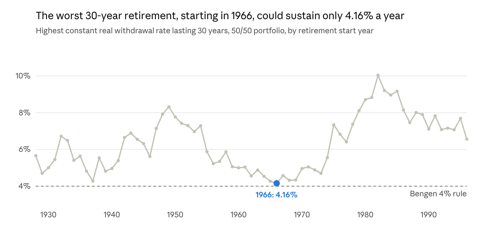
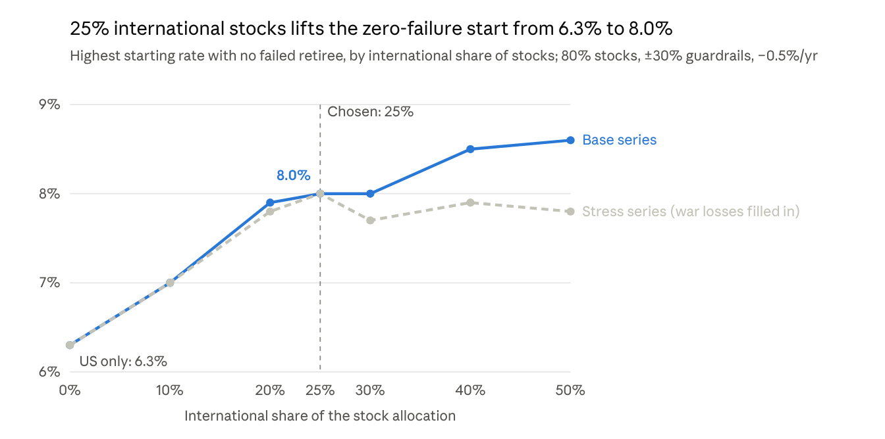

# Beyond the 4% Rule: A Historical Backtest

Nicky Sandhu · October 25, 2026

## Summary

Bengen's 4% rule held up in 1928–2025 history, but it is conservative. Flexible spending with a floor, about 80% stocks, gently front-loaded spending and 25% international stocks doubled the safe starting rate to 8.0% with zero historical failures. The unluckiest retiree still never spent less than roughly Bengen's $4.

Each row adds one change to the row above. Spending is in today's dollars per $100 of starting portfolio; "typical" is the median of 69 retirees.

| Change added | Safe starting rate | Typical spending, years 1–10 | Retirees failing (of 69) |
| --- | --- | --- | --- |
| Bengen: constant real spending, 50/50 US | 4.0% (max 4.16%) | $4.00 | 0 |
| Guardrails ±30%, $4 floor, 80% stocks | 5.5% | $5.67 | 0 |
| Real spending falls 0.5% a year, floor too | 6.3% | $6.29 | 0 |
| 25% of stocks international | 8.0% | $7.42 | 0 |
| Accept 95% success | 9.0% | $8.02 | 3 |

The price of the higher start is variable income. For the 8% plan, the unluckiest 5% of retirees reach the floor by year 6 and stay there, and typical spending drifts down over time. A realistic target is probably 1–1.5 points below these optimized figures.

## Method and data

Every result comes from 69 overlapping 30-year retirements starting each January from 1928 to 1996, run on actual annual returns. A retiree succeeds if real spending never drops below the floor and the money never runs out.

- Portfolio starts at $100, rebalanced to a fixed mix each year; withdrawals at year end; no fees or taxes.
- **Bengen rule:** first-year spending = rate × portfolio, then raised by inflation every year.
- **Guardrails rule:** spending rises with inflation, then is cut by the step if the current withdrawal rate is more than 20% above the starting rate, or raised by the step if more than 20% below. The step is the largest real change in any one year.
- **Floor and ceiling:** spending never goes below the floor ($4) or above an optional cap. With a declining plan, the floor declines at the same 0.5% a year, to $3.46 by year 30.

| Series | Source | Notes |
| --- | --- | --- |
| US stocks | Damodaran, S&P 500 total return, 1928–2025 | |
| Bonds | ½ 3-month T-bills + ½ 10-year Treasury (Damodaran) | Proxy for Bengen's intermediate-term government bonds |
| Inflation | US CPI-U, December to December | |
| International stocks, 1928–69 | Jordà-Schularick-Taylor Macrohistory R6, 15 developed countries in USD, weighted by real GDP | Wartime gaps skipped; a stress version fills them with heavy losses |
| International stocks, 1970–2025 | MSCI World ex USA, USD total return | Within ~2 points a year of MSCI EAFE |

## Bengen's result replicates

The rebuilt study matches Bengen (1994): with a 50/50 portfolio, the worst start year is 1966 and the highest rate lasting 30 years is 4.16%, against his roughly 4.15%. A 4% withdrawal lasted at least 32.9 years for every retiree.

*Computed from Damodaran S&P 500 and bond returns and US CPI · 69 retirements starting 1928–1996*

The typical retiree could have spent about 6.4%; 4% is set entirely by the late-1960s starts. As in the paper, 3% lasted 50 years in every case, 5% survived 30 years in only 63% of cases, and 50–75% stocks gave the longest worst-case life. Using 10-year Treasuries instead of the shorter-bond proxy lowers the 1966 figure to about 4.0%.

## Guardrails need a floor

Guardrails on their own made things worse. Without a floor, cuts compound in a bad stretch and rarely reverse: starting at 4%, the 1965–66 retirees ended up spending about $1.90 a year while still holding roughly their starting balance.

Adding a floor turns flexibility into a gain. On a 50/50 US portfolio starting at 5%:

| Spending rule | Retirees failing | Worst year's spending | Typical average spending |
| --- | --- | --- | --- |
| Constant real (Bengen) | 17 | $0 | $5.00 |
| Guardrails ±10%, no floor | 0 | $2.15 | $4.91 |
| Guardrails ±20%, floor at 80% of start | 0 | $4.00 | $4.87 |
| Guardrails ±10%, floor at 80% of start | 1 | $2.31 | $4.91 |

Small steps and a floor do not mix: cuts come too slowly, the floor props spending up, and the 1966 retiree runs dry in the last year. Larger steps (20–30%) with a floor worked best throughout.

## Allocation, front-loading, ceiling and leverage

With a $4 floor and guardrails, about 80% stocks gave the most spending with zero failures; front-loading helped only when the minimum also declined; a ceiling and leverage did not help. Figures below are US-only stocks.

- **About 80% stocks.** 80% stocks with ±30% steps supported a 5.5% start and $6.70 typical lifetime spending, with no failures. At 90% stocks or more, the 1929 retiree fails every combination: even a flat 4% at 100% stocks runs out after about 21 years.
- **Front-loading needs a declining floor.** Planning real spending to fall 0.5% a year lifted the zero-failure start from 5.5% to 6.3% only because the floor fell with it. With a flat $4 floor the drift added nothing: the worst retirees sit on the floor either way.
- **A ceiling never raised the starting rate.** The binding retirees never reach the cap. A cap only trades late splurges for a larger estate: at 95% success, a 1.25× cap raised the median ending balance from $79 to $92 per $100.
- **Leverage failed.** Holding 125%, 150% or 200% in stocks, financed at the T-bill rate plus 1%, failed at least 4, 9 and 16 of 69 retirees respectively. The early-1930s and late-1960s starts were wiped out.

## International diversification

Moving a quarter of the stocks abroad was the largest single gain: the zero-failure starting rate rose from 6.3% to 8.0% for the same strategy.

*Computed from Damodaran, JST Macrohistory R6 and MSCI World ex USA returns · 69 retirements starting 1928–1996 · 2× cap, declining $4 floor*

- **No return given up.** Over 1928–2025 a 75/25 US/international stock mix compounded at 10.0% a year, the same as US-only, with volatility down from 19.4% to 17.9%. The two markets' annual returns were only 0.6 correlated.
- **It rescues 1966.** International stocks held up far better through the 1970s and early 1980s, when US stagflation sank the 1966 retiree.
- **It survives the stress tests.** Filling the wartime data gaps with heavy losses (Japan 1946–47, Germany 1945, occupied Netherlands and Norway) leaves 25% unchanged at 8.0%. Even if international stocks had only matched US returns over 1970–89, the start still rises to 7.1%.
- **About 25% is enough.** Beyond it, the base series gains a little more but the stress series does not.

## Accepting 95% success

Allowing 3 failures in 69 retirements (95.7% success) raised the start from 8.0% to 9.0%. Typical first-decade spending rose from $7.42 to $8.02. Plan: 80% stocks (25% of them international), ±30% guardrails, 2× cap, real spending −0.5% a year.

The three failures are the 1929, 1962 and 1966 starts. Each holds the floor for decades, then runs out in year 26, 28 or 30.

Higher starts front-load more than the plan's 0.5% drift suggests:

| Median spending in each year, averaged by decade | Start 8.0% (100% success) | Start 9.0% (95% success) |
| --- | --- | --- |
| Years 1–10 | $7.55 | $7.97 |
| Years 11–20 | $6.37 | $5.93 |
| Years 21–30 | $5.34 | $4.74 |
| Share of all retiree-years spent at the floor | 19% | 19% |

The most aggressive plan without leverage was 100% stocks with ±25% steps: a 9.2% start and $8.44 typical first-decade spending, with the 1928 and 1929 starts failing.

## Caveats and takeaways

The optimized rates fit one history and should be read as an upper bound, not a plan.

**Caveats**

- **In-sample fit.** 69 overlapping periods hold only a handful of independent bad sequences; the best settings are partly tuned to them.
- **US and developed markets only.** Results are for a retiree spending US dollars over 1928–2025; they may not carry over to other countries or to the future.
- **Data proxies.** Bonds are a T-bill/10-year blend; international returns splice JST (1928–69) to MSCI (1970 on).
- **No fees or taxes.** A 0.5–1% annual cost would lower every rate.
- **Fixed 30-year horizon** and no other income such as pensions or Social Security.
- **Variable income.** About one retiree-year in five is spent at the floor.

**Takeaways**

1. Bengen's 4% is a sound floor: it never failed in this data.
2. If spending can flex, a hard floor plus large guardrail steps is what makes a higher start safe.
3. Hold roughly 70–80% stocks, with about a quarter abroad.
4. Front-load only by letting the minimum fall too; a ceiling is an estate decision, not a safety tool.
5. Avoid leverage.
6. A realistic starting rate under these rules is roughly 6.5–7%, 1–1.5 points below the optimized 8%.

## Reproducing the results

The Python project (pandas, numpy, matplotlib) regenerates every number and chart here from the bundled data in under a minute per script.

| Script | What it produces |
| --- | --- |
| `scripts/reproduce.py` | Bengen replication: longevity by start year, allocation table, 30-year maximum rates |
| `scripts/guardrails.py` | Guardrails vs Bengen across step sizes, with optional floor and ceiling |
| `scripts/optimize.py` | Best stocks × step × ceiling × drift at a chosen success rate (`--success 0.95`) |
| `scripts/intl_sweep.py` | Safe start vs international share, base and stress series |
| `scripts/build_intl.py` | Rebuilds the international return series from the JST dataset |

Defaults: intermediate-bond proxy, year-end withdrawals, ±20% guardrail band, 25% international in the experiment scripts (`--intl 0` for US-only).

### Sources

- [Damodaran, Historical Returns on Stocks, Bonds and Bills](https://pages.stern.nyu.edu/~adamodar/New_Home_Page/datafile/histretSP.html)
- [US Inflation Calculator, historical inflation rates](https://www.usinflationcalculator.com/inflation/historical-inflation-rates/)
- [Jordà-Schularick-Taylor Macrohistory Database R6 (copy used)](https://github.com/ejroebuck2025/JST_data_analysis)
- [MSCI World ex USA annual returns](https://www.upmyinterest.com/msci-world-ex-us/)
- [MSCI EAFE index factsheet](https://www.msci.com/documents/10199/a8a3ef21-f61a-4a4e-82aa-81c24481b783)
- William P. Bengen, "Determining Withdrawal Rates Using Historical Data", Journal of Financial Planning, October 1994
