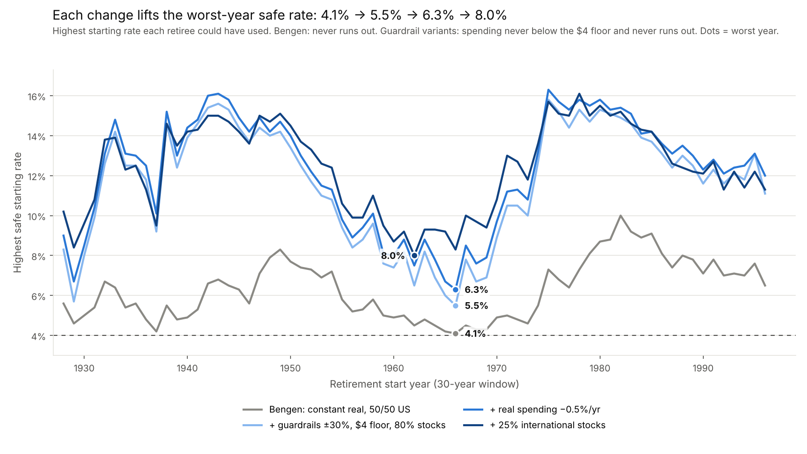
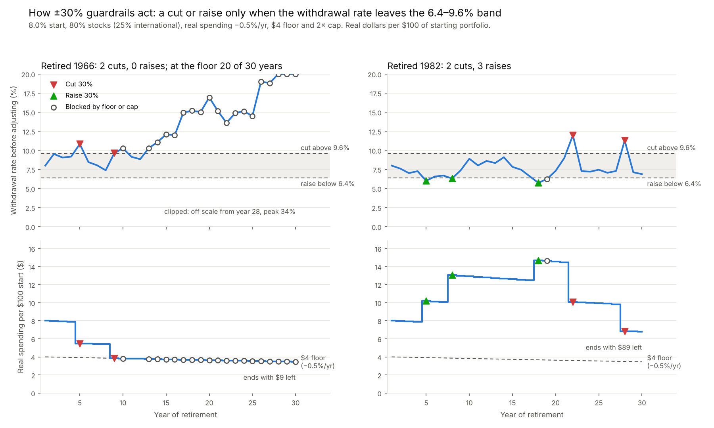
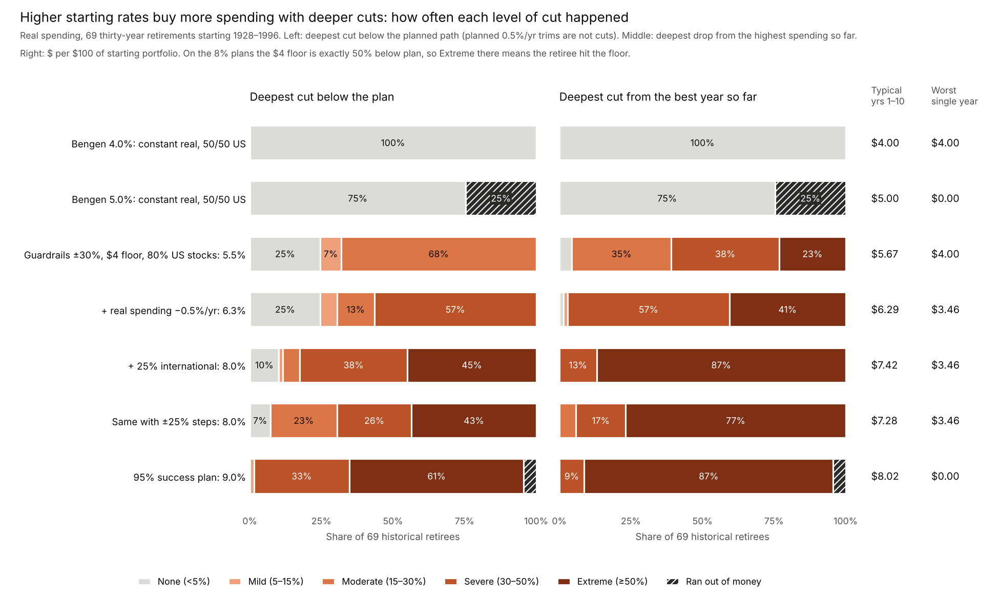
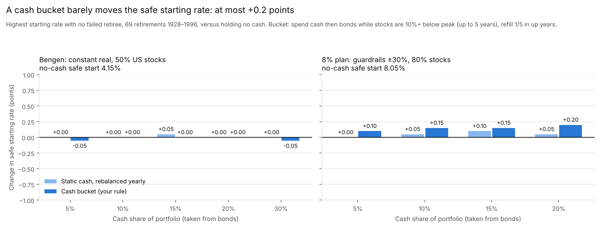
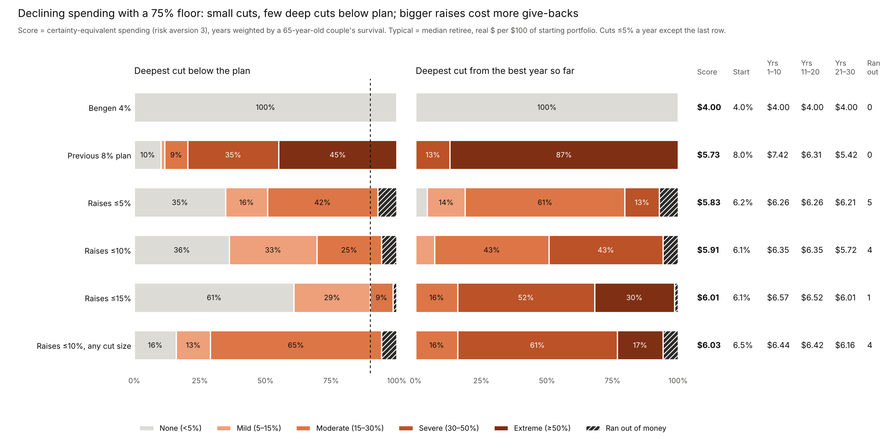
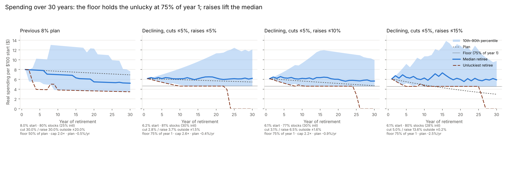
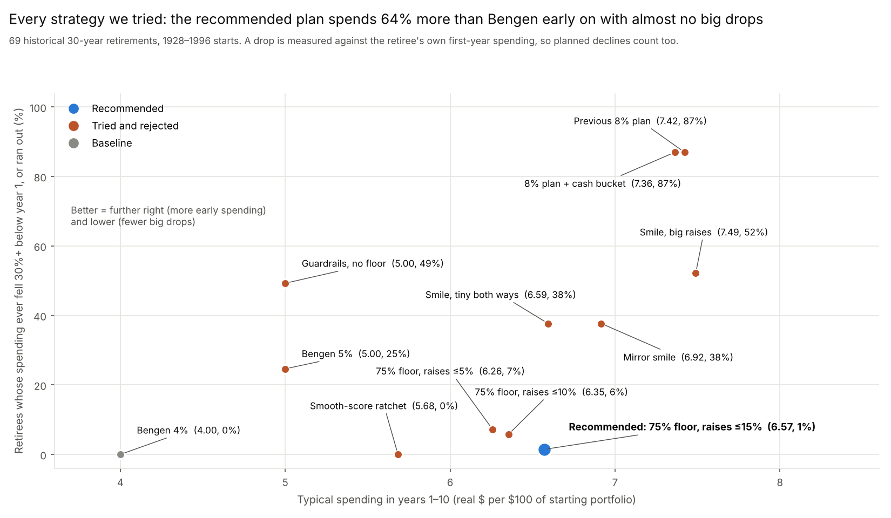

# Beyond the 4% Rule: A Historical Backtest

Nicky Sandhu · October 25, 2026

## Summary

Bengen's 4% rule held up in 1928–2025 history, but it is conservative. Flexible spending with a floor, about 80% stocks, gently front-loaded spending and 25% international stocks doubled the safe starting rate to 8.0% with zero historical failures. The unluckiest retiree still never spent less than roughly Bengen's $4.

Each row adds one change to the row above. Spending is in today's dollars per $100 of starting portfolio; "typical" is the median of 69 retirees.

| Change added | Safe starting rate | Typical spending, years 1–10 | Retirees failing (of 69) |
| --- | --- | --- | --- |
| Bengen: constant real spending, 50/50 US | 4.0% (max 4.16%) | $4.00 | 0 |
| Guardrails ±30%, $4 floor, 80% stocks | 5.5% | $5.67 | 0 |
| Real spending falls 0.5% a year, floor too | 6.3% | $6.29 | 0 |
| 25% of stocks international | 8.0% | $7.42 | 0 |
| Accept 95% success | 9.0% | $8.02 | 3 |

*Each line shows the highest starting rate a retiree starting that year could have used; its lowest point is the variant's safe rate in the table. For the guardrail variants "safe" means spending never fell below the $4 floor and the money lasted, so a high start in a good year (14% in 1980, say) is quickly cut back toward the floor rather than sustained. Mid-1960s starts are the hardest for every variant.*

The price of the higher start is variable income. For the 8% plan, the unluckiest 5% of retirees reach the floor by year 6 and stay there, and typical spending drifts down over time. A realistic target is probably 1–1.5 points below these optimized figures.

**Recommended plan.** Measured by how retirees actually experience spending, the 8% plan cuts too deep: 45% of retirees end up 50% below plan. After searching many alternatives (see [Experiments that didn't make the cut](#experiments-that-didnt-make-the-cut)), the plan we recommend starts at 6.1%, plans for real spending to fall 2.5% a year, and never lets spending go below 75% of the first year. Each year it cuts 5% or raises up to 13.6%, depending on the withdrawal rate. Typical spending is $6.57 a year in the first decade, 64% more than Bengen's $4, and only 1 of 69 historical retirees ran out (the 1929 start, in year 26). Late-life long-term care is best funded from a separate pot. Details in [Recommended plan](#recommended-plan-declining-spending-with-a-75-floor).

## Method and data

Every result comes from 69 overlapping 30-year retirements starting each January from 1928 to 1996, run on actual annual returns. A retiree succeeds if real spending never drops below the floor and the money never runs out.

- Portfolio starts at $100, rebalanced to a fixed mix each year; withdrawals at year end; no fees or taxes.
- **Bengen rule:** first-year spending = rate × portfolio, then raised by inflation every year.
- **Guardrails rule:** spending rises with inflation, then is cut by the step if the current withdrawal rate is more than 20% above the starting rate, or raised by the step if more than 20% below. The step is the largest real change in any one year.
- **Floor and ceiling:** spending never goes below the floor ($4) or above an optional cap. With a declining plan, the floor declines at the same 0.5% a year, to $3.46 by year 30.

| Series | Source | Notes |
| --- | --- | --- |
| US stocks | Damodaran, S&P 500 total return, 1928–2025 | |
| Bonds | ½ 3-month T-bills + ½ 10-year Treasury (Damodaran) | Proxy for Bengen's intermediate-term government bonds |
| Inflation | US CPI-U, December to December | |
| International stocks, 1928–69 | Jordà-Schularick-Taylor Macrohistory R6 (CC BY-NC-SA 4.0), 15 developed countries in USD, weighted by real GDP | Wartime gaps skipped; a stress version fills them with heavy losses |
| International stocks, 1970–2025 | MSCI World ex USA, USD total return | Within ~2 points a year of MSCI EAFE |

## Bengen's result replicates

The rebuilt study matches Bengen (1994): with a 50/50 portfolio, the worst start year is 1966 and the highest rate lasting 30 years is 4.16%, against his roughly 4.15%. A 4% withdrawal lasted at least 32.9 years for every retiree.

*Computed from Damodaran S&P 500 and bond returns and US CPI · 69 retirements starting 1928–1996*

The typical retiree could have spent about 6.4%; 4% is set entirely by the late-1960s starts. As in the paper, 3% lasted 50 years in every case, 5% survived 30 years in only 63% of cases, and 50–75% stocks gave the longest worst-case life. Using 10-year Treasuries instead of the shorter-bond proxy lowers the 1966 figure to about 4.0%.

## Guardrails need a floor

Guardrails on their own made things worse. Without a floor, cuts compound in a bad stretch and rarely reverse: starting at 4%, the 1965–66 retirees ended up spending about $1.90 a year while still holding roughly their starting balance.

Adding a floor turns flexibility into a gain. On a 50/50 US portfolio starting at 5%:

| Spending rule | Retirees failing | Worst year's spending | Typical average spending |
| --- | --- | --- | --- |
| Constant real (Bengen) | 17 | $0 | $5.00 |
| Guardrails ±10%, no floor | 0 | $2.15 | $4.91 |
| Guardrails ±20%, floor at 80% of start | 0 | $4.00 | $4.87 |
| Guardrails ±10%, floor at 80% of start | 1 | $2.31 | $4.91 |

Small steps and a floor do not mix: cuts come too slowly, the floor props spending up, and the 1966 retiree runs dry in the last year. Larger steps (20–30%) with a floor worked best throughout.

## How the ±30% guardrails work

The guardrails change spending only when the withdrawal rate drifts well away from where it started, and then by 30% at once. In most years nothing happens beyond the inflation raise.

Each January, for the 8% plan:

1. **Planned spending:** last year's spending, raised by inflation, then trimmed 0.5%.
2. **Check:** withdrawal rate = planned spending ÷ current portfolio.
3. **Act only outside the band:** above 9.6% (the starting 8% plus 20%) spending is cut 30%; below 6.4% (8% minus 20%) it is raised 30%. In between, nothing changes.
4. **Limits:** spending never goes below the $4 floor (itself declining 0.5% a year) or above the 2× cap, whatever the rule says.

"±30%" is the size of the move; the 6.4–9.6% band is what triggers it.

*8.0% start, 80% stocks (25% international), real spending −0.5% a year, $4 floor, 2× cap. Hollow circles: a cut or raise was triggered but the floor or cap stopped spending from moving.*

- **1966, a bad start.** Spending was cut 30% in year 5 and again in year 9, which brought it to the floor. It stayed there for 20 of the 30 years while the withdrawal rate climbed to 34%; the floor blocked every further cut. The portfolio ended with $9 left: tight, but it never ran out.
- **1982, a good start.** Spending was raised three times, to about $14.70 by year 18, then cut twice after the 2000s crashes. It still ended at $6.80 a year with $89 left.

Across all 69 retirees on this plan:

- Every retiree had at least one cut, typically three in 30 years, the first around year 6. Raises were as common, typically three.
- About 68% of years had no change beyond inflation and the 0.5% trim; about 10% had a cut and 10% a raise.
- 31 of the 69 retirees spent some years pinned at the floor.

Large steps win because small ones react too slowly: the portfolio drains before the cuts add up, and the floor then holds spending too high. Above 25% the step size barely matters:

| Guardrail step | Safe starting rate | Typical spending, years 1–10 |
| --- | --- | --- |
| ±10% | 7.0% | $6.85 |
| ±20% | 7.7% | $7.17 |
| ±25% | 8.0% | $7.29 |
| ±30% | 8.0% | $7.42 |

±25% gives the same 8.0% safe start with gentler swings, at a cost of about $0.13 a year of early spending. For someone who would find a 30% pay cut in one year hard to live with, it is the better choice.

## Allocation, front-loading, ceiling and leverage

With a $4 floor and guardrails, about 80% stocks gave the most spending with zero failures; front-loading helped only when the minimum also declined; a ceiling and leverage did not help. Figures below are US-only stocks.

- **About 80% stocks.** 80% stocks with ±30% steps supported a 5.5% start and $6.70 typical lifetime spending, with no failures. At 90% stocks or more, the 1929 retiree fails every combination: even a flat 4% at 100% stocks runs out after about 21 years.
- **Front-loading needs a declining floor.** Planning real spending to fall 0.5% a year lifted the zero-failure start from 5.5% to 6.3% only because the floor fell with it. With a flat $4 floor the drift added nothing: the worst retirees sit on the floor either way.
- **A ceiling never raised the starting rate.** The binding retirees never reach the cap. A cap only trades late splurges for a larger estate: at 95% success, a 1.25× cap raised the median ending balance from $79 to $92 per $100.
- **Leverage failed.** Holding 125%, 150% or 200% in stocks, financed at the T-bill rate plus 1%, failed at least 4, 9 and 16 of 69 retirees respectively. The early-1930s and late-1960s starts were wiped out.

## International diversification

Moving a quarter of the stocks abroad was the largest single gain: the zero-failure starting rate rose from 6.3% to 8.0% for the same strategy.

*Computed from Damodaran, JST Macrohistory R6 and MSCI World ex USA returns · 69 retirements starting 1928–1996 · 2× cap, declining $4 floor*

- **No return given up.** Over 1928–2025 a 75/25 US/international stock mix compounded at 10.0% a year, the same as US-only, with volatility down from 19.4% to 17.9%. The two markets' annual returns were only 0.6 correlated.
- **It rescues 1966.** International stocks held up far better through the 1970s and early 1980s, when US stagflation sank the 1966 retiree.
- **It survives the stress tests.** Filling the wartime data gaps with heavy losses (Japan 1946–47, Germany 1945, occupied Netherlands and Norway) leaves 25% unchanged at 8.0%. Even if international stocks had only matched US returns over 1970–89, the start still rises to 7.1%.
- **About 25% is enough.** Beyond it, the base series gains a little more but the stress series does not.

## Accepting 95% success

Allowing 3 failures in 69 retirements (95.7% success) raised the start from 8.0% to 9.0%. Typical first-decade spending rose from $7.42 to $8.02. Plan: 80% stocks (25% of them international), ±30% guardrails, 2× cap, real spending −0.5% a year.

The three failures are the 1929, 1962 and 1966 starts. Each holds the floor for decades, then runs out in year 26, 28 or 30.

Higher starts front-load more than the plan's 0.5% drift suggests:

| Median spending in each year, averaged by decade | Start 8.0% (100% success) | Start 9.0% (95% success) |
| --- | --- | --- |
| Years 1–10 | $7.55 | $7.97 |
| Years 11–20 | $6.37 | $5.93 |
| Years 21–30 | $5.34 | $4.74 |
| Share of all retiree-years spent at the floor | 19% | 19% |

The most aggressive plan without leverage was 100% stocks with ±25% steps: a 9.2% start and $8.44 typical first-decade spending, with the 1928 and 1929 starts failing.

## What it feels like: how often spending is cut

The higher starting rates are paid for with frequent deep cuts: most retirees on the aggressive plans lived through a cut of 30% or more, while Bengen's 4% never cut at all.

Each retiree is placed in a level by their deepest real spending cut, measured two ways:

- **Below the plan:** the deepest drop below planned spending. For the declining plans the planned 0.5% annual trim is not counted as a cut.
- **From the best year:** the deepest drop from the highest spending reached so far, so giving back earlier raises counts.

Levels: none (under 5%), mild (5–15%), moderate (15–30%), severe (30–50%), extreme (50% or more), and ran out of money. Shares are of the 69 historical retirees; because the 30-year windows overlap, they are frequencies, not true probabilities.

*On the 8% plans the $4 floor is exactly 50% below plan, so "extreme" there means the retiree hit the floor.*

| Strategy | Typical spending, yrs 1–10 | Cut ≥30% below plan | Cut ≥30% from best year | Years ≥15% below plan (median) |
| --- | --- | --- | --- | --- |
| Bengen 4.0% | $4.00 | 0% | 0% | 0 |
| Bengen 5.0% | $5.00 | 25% (ran out) | 25% (ran out) | 0 |
| Guardrails, US, 5.5% | $5.67 | 0% | 58% | 6 |
| + real spending −0.5%/yr, 6.3% | $6.29 | 57% | 97% | 6 |
| + 25% international, 8.0% | $7.42 | 83% | 100% | 14 |
| Same with ±25% steps, 8.0% | $7.28 | 70% | 94% | 13 |
| 95% success plan, 9.0% | $8.02 | 97% | 100% | 18 |

*"Cut ≥30%" includes retirees who ran out of money.*

- **Rigid spending hurts differently.** Bengen at 5% never cuts, but a quarter of retirees ran out of money, usually in the last five years. Guardrails trade that rare total loss for common partial cuts.
- **The US guardrails plan at 5.5% is the gentlest step up.** No retiree fell more than 27% below plan, because the $4 floor sits close to the $5.50 start; the cost is about 6 years spent 15% or more below plan.
- **The 8% plan doubles spending, but nearly half of retirees hit the floor**, a 50% cut, and a typical retiree spends 14 of 30 years at least 15% below plan.
- **Giving back raises is almost universal.** On the flexible plans nearly everyone at some point loses 30% or more from their best year, usually by losing earlier raises. Anyone who lets their lifestyle rise with every raise will feel that as a real cut.
- **±25% steps soften it a little:** fewer severe cuts (70% against 83%) and one year less below plan, for $0.14 a year less early spending.

## Does a cash bucket help?

A cash bucket used in down markets barely moves the safe starting rate: about +0.15–0.2 points on the 8% plan and nothing on Bengen's rule. It slightly softens the worst outcomes.

The rule tested:

1. **Funding:** cash comes out of bonds (80/20 becomes 80/10/10) and earns the T-bill rate.
2. **Trigger:** a downturn is when stocks are 10% or more below their previous peak.
3. **In a downturn:** spending comes from cash first, then bonds, for up to 5 years; stocks are not sold and the portfolio is not rebalanced.
4. **Refill:** afterwards, cash is topped up by a fifth of its target in each year stocks rose.

To separate the timing rule from simply holding cash, it is compared with no cash and with a static 10% cash share rebalanced every year.

| | No cash | Static 10% cash | 10% cash bucket |
| --- | --- | --- | --- |
| **Bengen, 50% stocks:** safe start | 4.16% | 4.18% | 4.14% |
| **8% plan:** safe start, no failures | 8.06% | 8.12% | 8.20% |
| **8% plan:** safe start, 95% success | 9.02% | 8.74% | 9.22% |
| **8% plan at 8%:** retirees cut ≥30% below plan | 77% | 78% | 74% |
| **8% plan at 8%:** worst ending balance | $2 | $4 | $6 |
| **8% plan at 8%:** median ending balance | $62 | $60 | $67 |
| **8% plan at 8%:** typical spending, yrs 1–10 | $7.42 | $7.36 | $7.36 |

Why it barely helps:

- **10% is not much money.** On the 8% plan it covers about 1.25 years of spending; the bad stretches lasted many years.
- **It misses the worst retirees.** The 1966 retiree's damage came in the 1970s, long after the first dip had drained the cash. Varying the cash from 5% to 20% of the portfolio, or the trigger from 0% to 20% below peak, never added more than about 0.35 points.
- **Rebalancing already does the job.** In a down year annual rebalancing buys stocks rather than selling them, so the bucket's gain over plain cash is about 0.1 point.

This matches the published research. [Estrada (2018)](https://www.advisorperspectives.com/articles/2019/01/07/does-the-bucket-approach-destroy-wealth) found buckets did worse than a static mix across 21 countries, and [Woerheide and Nanigan](https://www.kitces.com/blog/research-reveals-cash-reserve-strategies-dont-work-unless-youre-a-good-market-timer/) found cash buffers raised failure rates. [Early Retirement Now](https://earlyretirementnow.com/2021/09/14/bucket-strategies-swr-series-part-48/) found buckets help only with 6–10+ years of spending in cash, set up at a market peak. A bucket's main value is behavioural: not having to sell stocks in a crash, at almost no cost.

## Recommended plan: declining spending with a 75% floor

The recommended plan trades some early spending for almost no big drops: typical spending of $6.57 a year in years 1–10, no retiree's spending ever more than 25% below the first year, and 1 of 69 running out.

**The rule**, per $100 of starting portfolio:

1. **Start** at $6.08 (a 6.1% withdrawal) with 80% stocks, 28% of them international, and 20% bonds.
2. **Plan** for real spending to fall 2.5% a year: each year's planned spending is last year's raised by inflation, minus 2.5%.
3. **Adjust** against the starting withdrawal rate: if planned spending is more than 6.1% of the current portfolio, cut it 5%; if less, raise it up to 13.6%.
4. **Floor:** spending never goes below 75% of the first year in real terms ($4.56). Pay for late-life long-term care from a separate fund rather than from this portfolio.

The band is so narrow (±0.2%) that the rule acts nearly every year: about 45% of years bring a cut and 33% a raise. Because the plan declines 2.5% a year, it falls below the floor around year 12, after which the floor sets the minimum.

| Plan | Score | Start | Typical yrs 1–10 / 11–20 / 21–30 | Ran out (of 69) | Give back ≥30% from best year |
| --- | --- | --- | --- | --- | --- |
| Bengen 4% | $4.00 | 4.0% | $4.00 / $4.00 / $4.00 | 0 | 0% |
| Previous 8% plan | $5.73 | 8.0% | $7.42 / $6.31 / $5.42 | 0 | 100% |
| 75% floor, raises ≤5% | $5.83 | 6.2% | $6.26 / $6.26 / $6.21 | 5 | 20% |
| 75% floor, raises ≤10% | $5.91 | 6.1% | $6.35 / $6.35 / $5.72 | 4 | 49% |
| **Recommended: 75% floor, raises ≤15%** | **$6.01** | **6.1%** | **$6.57 / $6.52 / $6.01** | **1** | 84% |

*Score: certainty-equivalent spending with risk aversion 3, each year weighted by the chance that at least one of a 65-year-old couple is alive ([SSA 2022 period life table](https://www.ssa.gov/oact/STATS/table4c6_2022_TR2025.html)); it rewards spending that is high, steady and early. Optimised under three hard rules: international at most 30% of stocks, at most 10% of retirees cut 50%+ below plan or running out, and typical spending never rising from one decade to the next. Best of three search runs.*

- **Bigger raises make the plan safer, not riskier.** Raises build a cushion in good years. With raises capped at 5% or 10%, the floor blocks the cuts that would have saved the 1929, 1937, 1965 and 1966 retirees, and 4–5 run out late in retirement.
- **The cost is give-backs.** 84% of retirees at some point spend 30% less than their best year, as raises are trimmed back toward the declining plan. Cuts below the starting level stop at 25%, because of the floor.
- **It is sensitive to its exact settings.** It uses nearly the whole allowance of failures, so only about one in five small random nudges keeps every limit; round the start rate down in practice. The overall shape holds up when the search is rerun for a single person, risk aversion 2 or 5, or pessimistic international data. With US stocks only, the best start drops to 5.5%.

## Experiments that didn't make the cut

Each idea below was tested on the same 69 retirements and set aside; the chart places them all on two plain measures.

| Experiment | What we tried | Why it was set aside |
| --- | --- | --- |
| Higher fixed rate | Bengen's rule at 5% | A quarter of retirees ran out of money |
| Guardrails without a floor | ±10% steps on a ±20% band | Cuts compound; the worst retirees fell to about $2 |
| Leverage | 125–200% stocks, borrowing at T-bills + 1% | Failed 4–16 of 69 retirees at any starting rate |
| Spending ceiling | Caps of 1–3× the plan | Never raised the safe starting rate; only grows the estate |
| Cash bucket | 10% cash spent first in downturns, refilled later | Moved the safe start by at most 0.2 points |
| Smooth-score ratchet | Optimised for steady spending: 4.8% start, never cut, raise 13% when ahead | Back-loads spending (yrs 1–10 $5.68, yrs 21–30 $10); needed 45% international |
| Spending smile, big raises | Plan declines by decade; cuts ≤5%, raises up to 32% | 91% of retirees give back 30%+ of their best year |
| Spending smile, tiny both ways | Cuts and raises both ≤5% | Lower early spending ($6.59) and 22% of retirees 30%+ below plan |
| Mirror smile | Plan dips for 20 years, then rises at the same rate | Typical spending stayed flat; the late rise ran 2 retirees out of money |
| 75% floor with small raises | As recommended, raises ≤5% or ≤10% | 4–5 retirees ran out late; small raises never build a cushion |

## Caveats and takeaways

The optimized rates fit one history and should be read as an upper bound, not a plan.

**Caveats**

- **In-sample fit.** 69 overlapping periods hold only a handful of independent bad sequences; the best settings are partly tuned to them.
- **US and developed markets only.** Results are for a retiree spending US dollars over 1928–2025; they may not carry over to other countries or to the future.
- **Data proxies.** Bonds are a T-bill/10-year blend; international returns splice JST (1928–69) to MSCI (1970 on).
- **No fees or taxes.** A 0.5–1% annual cost would lower every rate.
- **Fixed 30-year horizon** and no other income such as pensions or Social Security.
- **Variable income.** About one retiree-year in five is spent at the floor, and on the 8% plan most retirees live through a cut of 30% or more.

**Takeaways**

1. Bengen's 4% is a sound floor: it never failed in this data.
2. If spending can flex, a hard floor plus large guardrail steps is what makes a higher start safe.
3. Hold roughly 70–80% stocks, with about a quarter abroad.
4. Front-load only by letting the minimum fall too; a ceiling is an estate decision, not a safety tool.
5. Avoid leverage. A cash bucket is harmless but adds little; hold one for peace of mind, not a higher rate.
6. For the smoothest experience, use the recommended plan: start near 6%, plan a 2.5% annual real decline, cut 5% or raise up to about 14% each year, and never go below 75% of the first year. Keep a separate fund for long-term care.
7. A realistic starting rate under these rules is roughly 6.5–7%, 1–1.5 points below the optimized 8%.

## Reproducing the results

The Python project (pandas, numpy, matplotlib) regenerates every number and chart here from the bundled data in under a minute per script.

| Script | What it produces |
| --- | --- |
| `scripts/reproduce.py` | Bengen replication: longevity by start year, allocation table, 30-year maximum rates |
| `scripts/guardrails.py` | Guardrails vs Bengen across step sizes, with optional floor and ceiling |
| `scripts/optimize.py` | Best stocks × step × ceiling × drift at a chosen success rate (`--success 0.95`) |
| `scripts/intl_sweep.py` | Safe start vs international share, base and stress series |
| `scripts/safemax_variants.py` | Highest safe start by retirement year for the four variants |
| `scripts/explain_guardrails.py` | Year-by-year guardrail decisions for chosen retirees, plus how often the rule acts |
| `scripts/pain_analysis.py` | How often each level of spending cut happens, by strategy |
| `scripts/cash_bucket.py` | Cash bucket vs no cash and static cash, with cash-size and trigger sensitivity |
| `scripts/decline_optimize.py`, `scripts/decline_charts.py` | Recommended plan: declining spending with a 75% floor and capped raises, optimised and charted |
| `scripts/experiment_map.py` | Every strategy tried on one chart: early spending vs big drops |
| `scripts/smooth_optimize.py`, `smile_optimize.py` (+ charts) | The smooth-score and spending-smile experiments |
| `scripts/build_intl.py` | Rebuilds the international return series from the JST dataset |

Defaults: intermediate-bond proxy, year-end withdrawals, ±20% guardrail band, 25% international in the experiment scripts (`--intl 0` for US-only).

### Sources

- [Damodaran, Historical Returns on Stocks, Bonds and Bills](https://pages.stern.nyu.edu/~adamodar/New_Home_Page/datafile/histretSP.html)
- [US Inflation Calculator, historical inflation rates](https://www.usinflationcalculator.com/inflation/historical-inflation-rates/)
- [Jordà-Schularick-Taylor Macrohistory Database R6](https://www.macrohistory.net/database/) ([copy used](https://github.com/ejroebuck2025/JST_data_analysis)), licensed CC BY-NC-SA 4.0. Cite: Jordà, Schularick and Taylor (2017), "Macrofinancial History and the New Business Cycle Facts", *NBER Macroeconomics Annual 2016*, vol. 31; and Jordà, Knoll, Kuvshinov, Schularick and Taylor (2019), "The Rate of Return on Everything, 1870–2015", *Quarterly Journal of Economics* 134(3)
- [MSCI World ex USA annual returns](https://www.upmyinterest.com/msci-world-ex-us/)
- [MSCI EAFE index factsheet](https://www.msci.com/documents/10199/a8a3ef21-f61a-4a4e-82aa-81c24481b783)
- William P. Bengen, "Determining Withdrawal Rates Using Historical Data", Journal of Financial Planning, October 1994
- [Early Retirement Now, Retirement Bucket Strategies (SWR Series Part 48)](https://earlyretirementnow.com/2021/09/14/bucket-strategies-swr-series-part-48/)
- [Kitces, Research Reveals Cash Reserve Strategies Don't Work Unless You're a Good Market Timer](https://www.kitces.com/blog/research-reveals-cash-reserve-strategies-dont-work-unless-youre-a-good-market-timer/)
- [Estrada, "Does the Bucket Approach Destroy Wealth?" (Advisor Perspectives)](https://www.advisorperspectives.com/articles/2019/01/07/does-the-bucket-approach-destroy-wealth)
- [Social Security Administration, Actuarial Life Table (2022 period, 2025 Trustees Report)](https://www.ssa.gov/oact/STATS/table4c6_2022_TR2025.html)
- [Kitces on Blanchett's retirement spending smile](https://www.kitces.com/?p=14475) and [safe withdrawal rates with decreasing spending](https://www.kitces.com/blog/safe-withdrawal-rates-with-decreasing-retirement-spending/)

### Licence

The international figures and charts in this write-up use data derived from the JST Macrohistory Database and are shared under [CC BY-NC-SA 4.0](https://creativecommons.org/licenses/by-nc-sa/4.0/): non-commercial use only, with attribution, under the same licence. The code is MIT-licensed.
